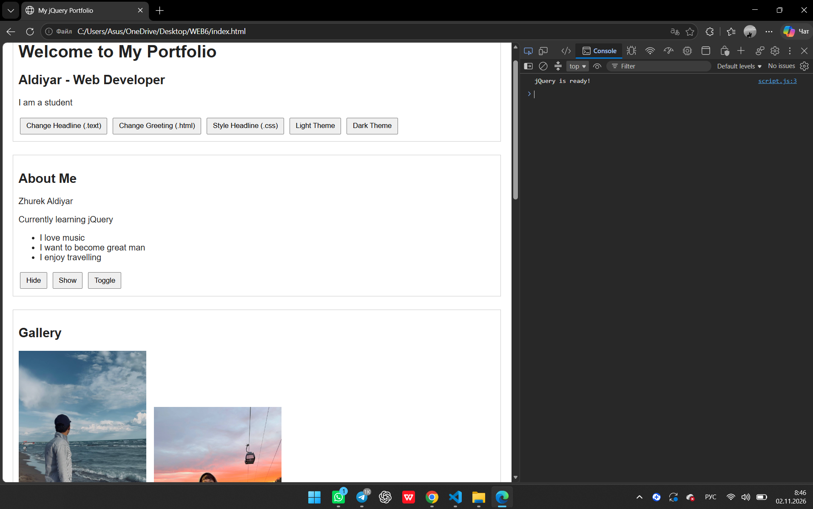
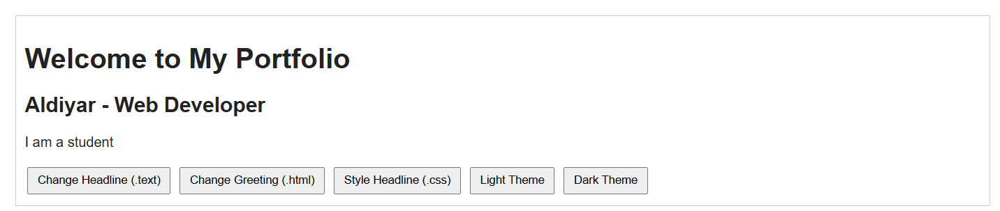
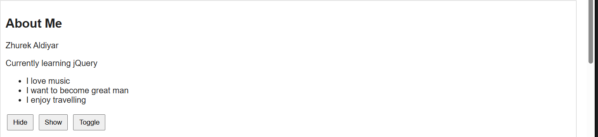
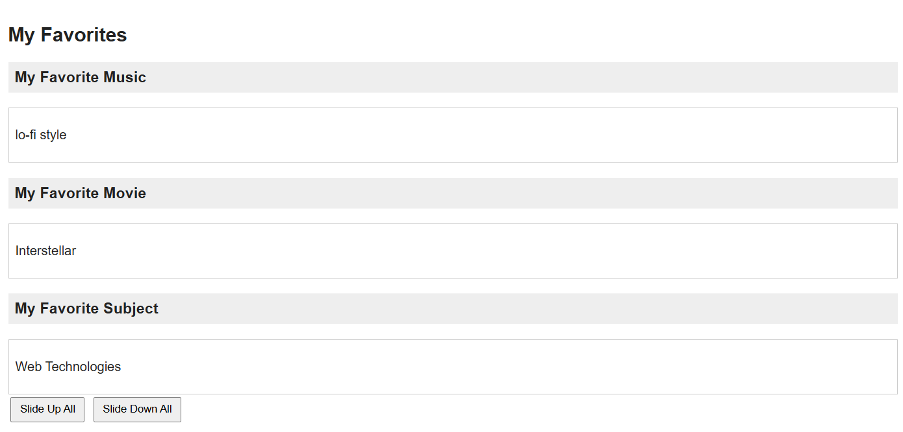
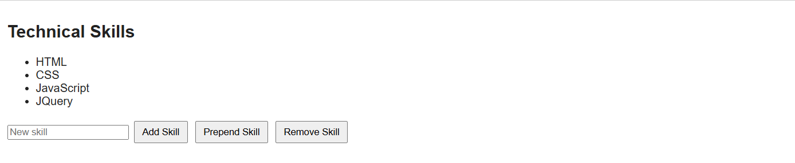
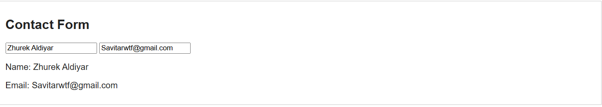
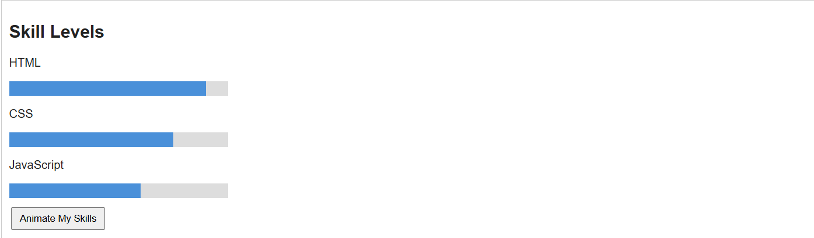

# Assignment 6. jQuery (Selectors, Effects, Animations)

*Name:* Zhurek Aldiyar
*Group:* Se-2540

*GitHub Pages:* https://github.com/savitarwtf-prog/Web-6.git

---

# Part 1. Getting Started with jQuery

## Task 0. Setup

## Task 1. Selectors & CSS

# Part 2. jQuery Effects

## Task 2. Visibility Methods

## Task 3. Fade Methods

## Task 4. Slide Methods

# Part 3. DOM Manipulation with jQuery

## Task 5. Add & Remove Elements

### Task 6. Modifying Attributes

### Task 7. Form Interaction

## Part 4. Animations

### Task 8. Basic Animation

## Summary of my work process
I created `index.html` with a section for each task, `style.css` for basic styling and `script.js` for all jQuery code. I started with the setup (CDN and document ready), then did selectors and CSS, effects (show/hide, fade, slide), DOM manipulation (append, prepend, remove, attr, val) and finally the animation of skill bars with `.animate()`. I tested each task in the browser and checked the console for errors, then uploaded the project to GitHub.
